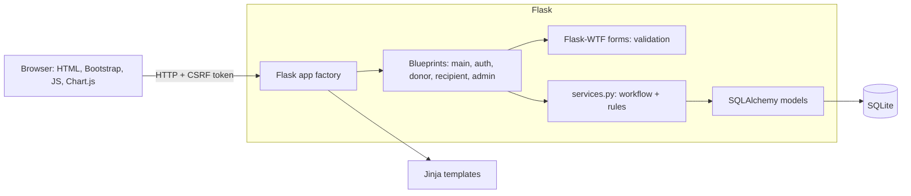
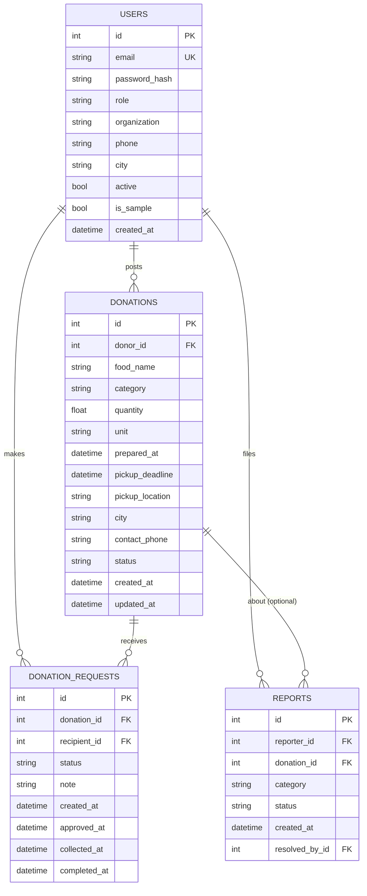
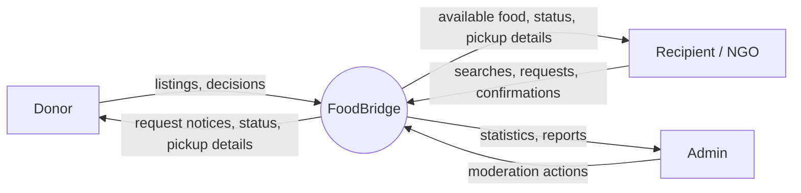
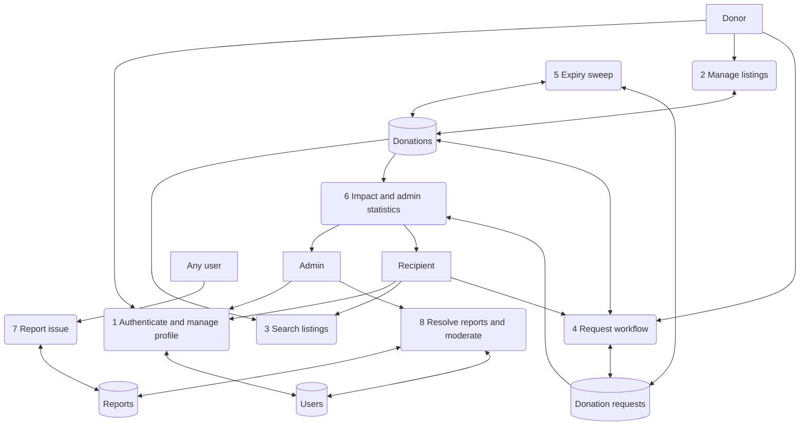
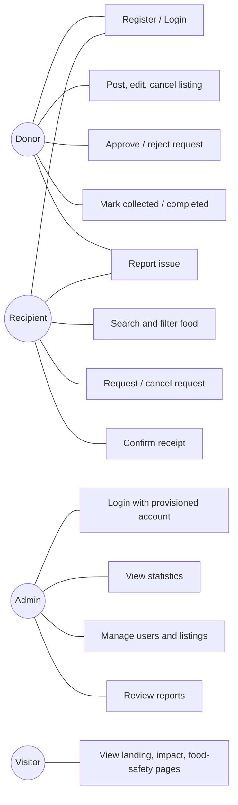
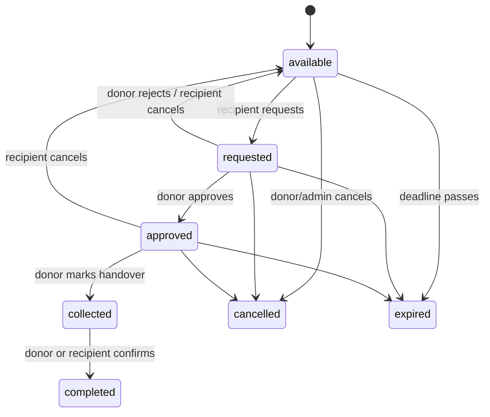

# FoodBridge: Smart Food Donation and Redistribution Platform
## Project Report

## 1. Title Page Details (fill in)
| Field | Value |
|---|---|
| Project title | FoodBridge: Smart Food Donation and Redistribution Platform |
| Student name(s) / Roll no(s) | |
| Programme / Branch | B.Tech CSE (Data Science) |
| Semester / Year | |
| Guide / Supervisor | |
| Department / Institution | |
| Submission date | |

## 2. Abstract
Large quantities of edible food are discarded by restaurants, hotels, canteens, hostels and events while NGOs and
shelters struggle to source meals. FoodBridge is a web platform that lets donors list surplus food with quantity,
preparation time, pickup deadline and handling notes, and lets verified recipient organizations search, request and
collect it. A strict, server-validated workflow (available → requested → approved → collected → completed) with
rejection, cancellation and automatic expiry prevents duplicate or invalid claims. Dashboards for donors, recipients
and administrators, and an impact dashboard that reports quantities per unit, make outcomes measurable. The system is
built with Flask, SQLAlchemy/SQLite, Bootstrap and Chart.js and is secured with hashed passwords, CSRF protection,
server-side authorization and rate limiting. FoodBridge coordinates pickups only; it is not a food-safety certifier.

## 3. Introduction
Food redistribution depends on timing: cooked food has a short safe window. Phone calls and messaging groups are slow
and leave no record. FoodBridge provides a shared, time-aware marketplace with accountability for both parties.

## 4. Problem Statement
There is no simple, trustworthy way for food donors to announce surplus and for NGOs to claim it within its safe
window, while tracking what was actually redistributed and respecting privacy and food-safety responsibilities.

## 5. Objectives and Scope
**Objectives:** (1) connect donors and recipients; (2) enforce a safe, auditable request workflow; (3) handle
deadlines and expiry; (4) report impact without mixing units; (5) secure the system and protect contact data.

**In scope:** web app, three roles, listings, search, request workflow, dashboards, reports, seeded demo data, tests.
**Out of scope:** food-safety certification, payments, logistics/routing, SMS/email notifications, native mobile apps,
third-party integrations needing API keys.

## 6. Existing System and Proposed System
**Existing:** informal WhatsApp/phone coordination, no status tracking, no expiry awareness, no impact data, personal
phone numbers widely shared.
**Proposed:** FoodBridge: structured listings, search filters, one-active-request rule, donor approval before sharing
contact details, automatic expiry, per-unit impact analytics, admin moderation.

## 7. Requirements
**Functional:** registration/login/profile; role-based access; create/edit/cancel listings; search & filter; request,
approve, reject, cancel, collect, complete; dashboards for each role; admin management and reports; impact
dashboard; expiry handling; seed data.
**Non-functional:** security (hashing, CSRF, authorization, rate limiting); usability and accessibility (responsive,
labelled forms, skip link, focus styles, contrast); reliability (DB constraints, transactions with rollback);
maintainability (blueprints, service layer, tests); privacy (minimal contact exposure); portability (SQLite, no keys).

## 8. Software and Hardware Requirements
| Software | Version |
|---|---|
| Python | 3.10+ |
| Flask, Flask-SQLAlchemy, SQLAlchemy | 3.x, 3.1+, 2.x |
| Flask-Login, Flask-WTF, WTForms | 0.6.3+, 1.2+, 3.1+ |
| SQLite | bundled with Python |
| Bootstrap / Chart.js | 5.3.3 / 4.4.3 (CDN) |
| pytest | 8+ |
| Browser | Current Chrome, Edge, Firefox or Safari |

Hardware: any machine with ≥ 2 GB RAM, 1 GHz CPU, 200 MB disk.

## 9. System Architecture

Layers: presentation (templates/static), controllers (blueprints), business rules (`services.py`), persistence
(`models.py`). All status changes pass through `services.apply_action`.

## 10. ER Diagram

## 11. Data Flow Diagrams
**Level 0**

**Level 1**

## 12. Use-Case Diagram

## 13. Database Schema
**users**: id PK; name; email UNIQUE INDEX; password_hash; role CHECK(donor|recipient|admin) INDEX; organization;
org_type; phone; city; address; active; is_sample; created_at.
**donations**: id PK; donor_id FK→users INDEX; food_name; category INDEX; quantity CHECK(>0); unit; description;
prepared_at; pickup_deadline; pickup_location (private); city INDEX; contact_phone (private); handling_notes; status
CHECK(7 values); is_sample; created_at; updated_at; composite INDEX(status, pickup_deadline).
**donation_requests**: id PK; donation_id FK INDEX; recipient_id FK; status CHECK(7 values); note; response_note;
created_at, approved_at, rejected_at, cancelled_at, expired_at, collected_at, completed_at; INDEX(recipient_id,
status); **partial UNIQUE INDEX(donation_id) WHERE status IN (pending, approved, collected)**.
**reports**: id PK; reporter_id FK; donation_id FK (ON DELETE SET NULL); category; description; status
CHECK(open|resolved|dismissed); admin_note; created_at; resolved_at; resolved_by_id FK.

Status model:

## 14. Module Descriptions
- **auth**: registration (donor/recipient only), login with generic errors, POST logout, rate limiting.
- **main**: landing, impact, food-safety page, profile, password change, issue reporting.
- **donor**: dashboard, listing CRUD, request decisions, handover and completion.
- **recipient**: search/filter, listing detail, requests, cancel, confirm receipt.
- **admin**: statistics, users (activate/deactivate), listings (remove), requests, reports.
- **services**: workflow engine, expiry sweep, statistics (per-unit aggregation).
- **forms / models / utils / cli / seed**: validation, schema, helpers, commands, demo data.

## 15. Implementation Details
- **App factory** loads config, validates `SECRET_KEY` (mandatory in production), registers blueprints, CLI,
  error handlers, security headers and an expiry hook that runs before each request.
- **Transition table** (`services.ACTIONS`) maps each action to allowed current states, resulting states, permitted
  actor and timestamp column. Authorization is checked first (403), then the transition (friendly error).
- **One active request per listing** is enforced in code and by the partial unique index, so concurrent clicks
  cannot both succeed.
- **Expiry**: overdue available/requested/approved listings become *expired* and their open requests *expired*.
- **Privacy**: address and phone are rendered only when `request.contact_visible` (approved, collected, completed).
- **Impact** aggregates completed requests with `GROUP BY unit`; units are never summed together.
- **Search** uses escaped, case-insensitive `LIKE`; quantity filtering requires choosing a unit.
- **Time** is stored as naive local time in `APP_TIMEZONE` via a single `now_local()` helper.

## 16. Test Cases and Actual Results
> **Honesty note:** the automated suite was written alongside the code but **could not be executed in the
> environment where the project was generated** (required packages could not be installed). Template rendering was
> smoke-tested with stub data and all Python files compile. Run `pytest` and record the real outcome below; do not
> submit these cells as passed until you have.

Command: `pytest -v`   Date run: ________   Python: ________   Overall: ____ passed / ____ failed

| ID | Test area | File | Expected result | Actual result |
|---|---|---|---|---|
| T1 | Registration (donor, recipient), hashed password | test_auth.py | Account created, hash ≠ password | |
| T2 | Registration validation, duplicates, no admin signup | test_auth.py | Rejected with messages, no user | |
| T3 | Login success redirects by role | test_auth.py | Correct dashboard | |
| T4 | Invalid / unknown / deactivated login | test_auth.py | Generic error, no session | |
| T5 | Logout POST-only, safe `next` redirects | test_auth.py | 405 on GET; local redirects only | |
| T6 | CSRF enforced, rate limit, headers, secret key | test_auth.py | 400 / 429 / headers / RuntimeError | |
| T7 | Profile update, password change, `create-admin` CLI | test_auth.py | Persisted; weak password refused | |
| T8 | Anonymous redirect, wrong-role 403 | test_access_control.py | 302 login / 403 | |
| T9 | Admin dashboard and pages, user toggle, reports | test_access_control.py | Admin 200; others 403 | |
| T10 | Create donation + 13 invalid variants | test_donations.py | Valid saved; invalid rejected | |
| T11 | Edit / cancel rules and ownership | test_donations.py | Owner only; locked after request | |
| T12 | Browse, search, filters, pagination, wildcard escape | test_donations.py | Correct subsets | |
| T13 | Contact details hidden until approval | test_donations.py | Absent, then present | |
| T14 | Request, duplicate, one-active-request | test_workflow.py | Second request blocked | |
| T15 | Approve / reject | test_workflow.py | Statuses and timestamps updated | |
| T16 | Unauthorized and invalid transitions, GET blocked | test_workflow.py | 403 / friendly error / 405 | |
| T17 | Collection and completion lifecycle | test_workflow.py | completed with timeline | |
| T18 | Expired and unavailable listings | test_workflow.py | Cannot request; auto-expire | |
| T19 | DB partial unique index | test_workflow.py | IntegrityError on 2nd active | |
| T20 | Impact per-unit totals | test_workflow.py | kg / servings / packets separate | |
| T21 | Seeding, labelling, reset, landing flag | test_seed.py | Sample rows flagged, no admin | |

## 17. Screenshots Checklist
☐ Landing page (desktop & mobile) ☐ Register ☐ Login ☐ Donor dashboard ☐ Post surplus food form with validation
errors ☐ Listing detail (donor) ☐ Browse with filters ☐ Listing detail (recipient) ☐ Request detail before and after
approval ☐ Pending-requests table ☐ Impact dashboard with charts ☐ Admin dashboard ☐ Admin users / listings / reports
☐ Expired-listing notice ☐ Food-safety page ☐ pytest output ☐ Terminal showing `create-admin` and `seed-demo`.

## 18. Limitations
Single time zone; SQLite and in-memory rate limiter are for demos; no notifications, maps or images; first-come,
one-request-per-listing model; no formal recipient verification process; CDN assets; registration reveals existing
emails; no food-safety verification (by design).

## 19. Future Scope
Flask-Migrate; email/SMS alerts; map search with distance; recipient verification workflow; ratings; partial
quantity allocation; demand forecasting and waste-hotspot analytics (Data Science); REST API/mobile app; PostgreSQL;
multilingual interface; scheduled expiry jobs.

## 20. Conclusion and References
FoodBridge delivers an end-to-end donor-to-recipient workflow with server-enforced rules, privacy-aware contact
sharing and honest per-unit impact reporting, forming a solid base for a real-world pilot after the production
hardening steps listed in the README.

**References** (verify current versions when citing): Flask documentation (flask.palletsprojects.com);
SQLAlchemy 2.0 documentation; Flask-Login; Flask-WTF / WTForms; Bootstrap 5.3 documentation; Chart.js documentation;
OWASP Application Security Verification Standard and Cheat Sheet Series; FSSAI food-safety guidance
(fssai.gov.in); pytest documentation.
